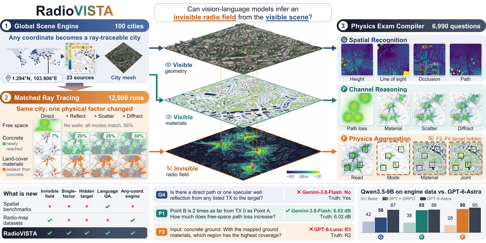
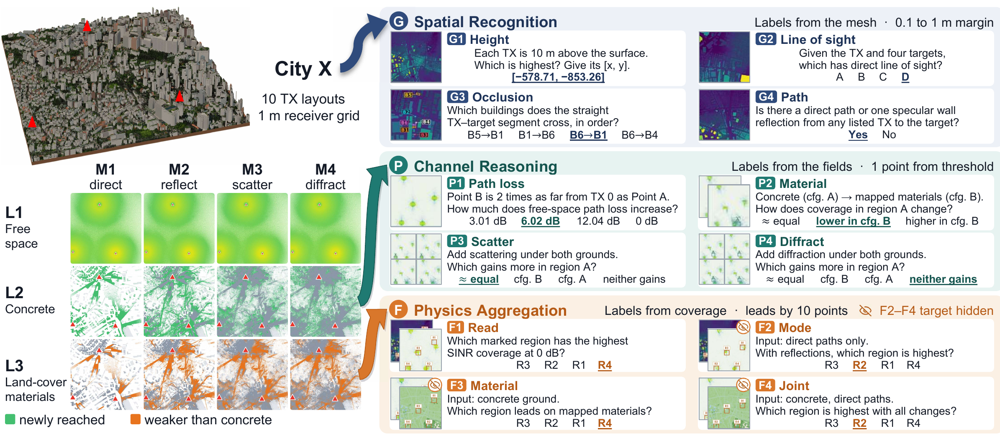

<div align="center">

# RadioVISTA

### Seeing the Invisible: How Vision-Language Models Read, Predict and Trace Radio Fields

Yiyang Zhu · Xin Li · Guangyuan Liu · Ziheng Liu · Jiayi Zhang · Chau Yuen

[](https://radiovista.github.io)
[](https://arxiv.org/abs/2611.28123)
[](https://huggingface.co/datasets/ScreeperC/radiovista-bench)
[](https://github.com/RadioVISTA/radiovista-bench)
[](LICENSE)



</div>

**TL;DR.** Buildings and streets shape radio signals that cameras cannot see. **RadioVISTA** tests whether vision-language models can read, predict and trace these invisible fields through 12 tasks across 100 real cities. Frontier models can read the field but struggle to trace individual paths; engine-generated training data improves field reasoning while path tracing remains an open problem.

## 🔥 News

- **[2026-11]** Paper available on [arXiv](https://arxiv.org/abs/2611.28123), with the [project website](https://radiovista.github.io) online.
- **[2026-11]** Benchmark questions, images, answers and city-disjoint splits released on [Hugging Face](https://huggingface.co/datasets/ScreeperC/radiovista-bench).
- **[2026-11]** Scene engine repository created. Code and raw simulated fields will be released in stages; see the [roadmap](#release-roadmap).

## Release Roadmap

| Status | Item | Target |
| :---: | --- | --- |
| ✅ | Paper and project website | 2026-11 |
| ✅ | Benchmark dataset: all 12 tasks, images, answers and splits | 2026-11 |
| ✅ | Scene engine repository and README | 2026-11 |
| ⬜ | Evaluation toolkit: answer parser, scorer, model backends and reproducible commands | TBA |
| ⬜ | Official scores, raw predictions and public leaderboard | TBA |
| ⬜ | Training baselines: SFT and GRPO recipes, fine-tuned Qwen3.5-9B LoRA weights | TBA |
| ⬜ | Raw simulated fields (`ScreeperC/radiovista-raw`) | Before scene engine |
| ⬜ | Scene engine: coordinates to ray-traced cities, radio fields and new questions | TBA |

Evaluation and training releases will live in [RadioVISTA/radiovista-bench](https://github.com/RadioVISTA/radiovista-bench). **This repository hosts the scene engine.**

## Overview



- **Any city on Earth.** A label-free engine turns coordinates into a ray-traceable 3D city using a uniform global baseline of buildings, terrain, land cover and roads.
- **Exact answers, zero annotation.** Answers are computed from simulated fields. Each new city or physical setting yields a fresh, exactly graded test suite and training data for SFT and reinforcement fine-tuning.
- **Controlled physics.** Each scene combines three environments and four propagation modes. Matched single-factor counterfactuals isolate reflection, scattering, diffraction and ground materials.
- **Physical validation.** In free space, the solver agrees with Friis law within 3 dB on 98% of 3,000 distance rings.
- **Global coverage.** The benchmark covers 100 real cities on six continents, with test cities strictly disjoint from training.

## Benchmark

Twelve tasks test three competences: geometry, propagation and field reasoning.

| Competence | Tasks | What it tests |
| --- | --- | --- |
| **Geometry** | G1 transmitter height, G2 line of sight, G3 building occlusion, G4 path reachability | Transmitter geometry, visibility and direct or one-wall path existence |
| **Propagation** | P1 free-space loss, P2 reflection, P3 scattering, P4 diffraction | How the signal responds to one physical change |
| **Field** | F1 field reading, F2 mode prediction, F3 material prediction, F4 joint prediction | Reading and predicting the full field |

| Split | Cities | Questions |
| --- | :---: | :---: |
| Train | 68 | 4,735 |
| Validation | 15 | 1,055 |
| Test | 17 | 1,200 |

## Main Findings

- **Field-path dissociation.** Frontier VLMs accurately judge where a field is strong, but fail to tell whether a single direct or one-wall path exists.
- **Open models fail earlier.** They struggle to read the field itself and score below random guessing even when credited for any of four attempts.
- **Engine data teaches the field.** Fine-tuning a 9B open model on unseen cities brings it close to frontier proprietary models on field tasks.
- **Path tracing stays out of reach.** Neither supervised nor reinforcement fine-tuning improves single-path geometry.

Full results and experimental protocols are in the [paper](https://arxiv.org/abs/2611.28123).

## Installation

Coming with the scene engine release. The current repository contains the package scaffold.

## Data

Benchmark questions, images, answers and train / validation / test splits are available on [Hugging Face](https://huggingface.co/datasets/ScreeperC/radiovista-bench).

Raw simulated fields (`ScreeperC/radiovista-raw`) will be released before the scene engine.

## Usage

Coming with the scene engine release: generate a 3D city from coordinates, simulate radio fields and synthesize new questions.

For benchmark evaluation and post-training, follow [RadioVISTA/radiovista-bench](https://github.com/RadioVISTA/radiovista-bench).

## Related Repositories

| Repository | Contents |
| --- | --- |
| [RadioVISTA/radiovista](https://github.com/RadioVISTA/radiovista) (this repo) | Scene engine and field generation |
| [ScreeperC/radiovista-bench](https://huggingface.co/datasets/ScreeperC/radiovista-bench) | Benchmark questions, images and answers |
| [RadioVISTA/radiovista-bench](https://github.com/RadioVISTA/radiovista-bench) | Evaluation toolkit and training baselines |
| [RadioVISTA/RadioVISTA.github.io](https://github.com/RadioVISTA/RadioVISTA.github.io) | Project website |

## Citation

```bibtex
@article{zhu2026radiovista,
  title   = {Seeing the Invisible: How Vision-Language Models
             Read, Predict and Trace Radio Fields},
  author  = {Zhu, Yiyang and Li, Xin and Liu, Guangyuan and
             Liu, Ziheng and Zhang, Jiayi and Yuen, Chau},
  journal = {arXiv preprint arXiv:2611.28123},
  year    = {2026},
  doi     = {10.48550/arXiv.2611.28123},
  url     = {https://arxiv.org/abs/2611.28123}
}
```

## License

Code: [GPL-3.0-only](LICENSE). Data: see the dataset card on Hugging Face.
